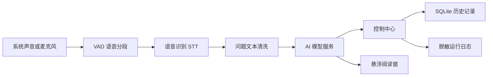

# AI 面试助手

AI 面试助手是一款面向 Windows 的实时面试辅助工具。它能够监听系统声音或麦克风，将语音转换为文字，再调用兼容 OpenAI Chat Completions 的模型服务生成回答建议，并同步显示在控制中心和独立悬浮阅读窗中。

项目重点解决三个问题：

- 面试过程中快速获得结构清晰、可直接口述的回答建议。
- 在不遮挡面试界面的前提下查看问题和回答。
- 将音频、识别、模型调用等耗时任务与界面线程隔离，保持操作流畅。

## 主要功能

| 模块 | 功能 |
| --- | --- |
| 实时面试 | 开始、停止、手动识别最近一段音频、取消回答生成 |
| 音频采集 | WASAPI Loopback 系统声音、麦克风输入、音量电平显示 |
| 说话检测 | 基于音频能量的 VAD，自动判断一段话是否结束 |
| 语音识别 | 讯飞听写、OpenAI Whisper、本地 faster-whisper |
| AI 回答 | DeepSeek、OpenAI、OpenAI 兼容服务 |
| 模型辅助 | 自动获取模型列表、一键测试 AI 是否可用 |
| 悬浮阅读窗 | 置顶显示、拖动、拉伸缩放、字号调整、透明度调整 |
| 历史记录 | SQLite 本地保存，支持搜索、查看、复制和清空 |
| 运行日志 | 在应用内查看运行状态、接口错误和识别结果 |
| 隐私保护 | API Key 存入 Windows 凭据管理器，日志自动脱敏 |

## 工作原理



应用启动后会创建控制中心、悬浮阅读窗和系统托盘。音频采集、语音识别、AI 请求、数据库写入均在后台线程执行，界面通过 Qt 信号接收结果。

### 一次问答的完整流程

1. 应用持续读取所选音频设备，并计算音量电平。
2. VAD 检测到持续说话后开始缓存音频。
3. 静音时间达到设置值后，将完整语音片段交给识别服务。
4. 识别文本经过关键词纠正，作为面试官问题显示。
5. AI 客户端使用当前模型、系统提示词、简历上下文和历史对话生成回答。
6. 回答以流式文本写入悬浮窗；完成后保存到本地历史记录。

## 系统要求

- Windows 10 或 Windows 11，64 位
- Python 3.11 或更高版本
- 可访问所选语音识别和 AI 服务的网络
- 讯飞、OpenAI、DeepSeek 或兼容服务凭据

## 从源码运行

```powershell
git clone <your-repository-url>
cd ai_interview
python -m venv .venv
.\.venv\Scripts\python.exe -m pip install -r requirements.txt
.\.venv\Scripts\python.exe main.py
```

如需运行测试，请安装开发依赖：

```powershell
.\.venv\Scripts\python.exe -m pip install -r requirements-dev.txt
$env:QT_QPA_PLATFORM = "offscreen"
.\.venv\Scripts\python.exe -m pytest
```

## 首次配置

首次启动会进入配置向导。建议按以下顺序完成：

1. 选择音频来源。
2. 选择语音识别服务并填写对应凭据。
3. 配置 AI 模型服务。
4. 设置悬浮窗的默认字号、透明度和置顶状态。

所有 API Key 和 Secret 默认以密码形式隐藏，保存后写入 Windows 凭据管理器，不会保存到普通配置文件中。

## 音频设置

### 音频来源

| 模式 | 适用场景 | 说明 |
| --- | --- | --- |
| 系统声音 | 在线会议、网页面试 | 使用当前默认扬声器的 WASAPI Loopback |
| 麦克风 | 线下交流、现场面试 | 使用指定输入设备或系统默认麦克风 |

如果能看到音量电平但没有生成问题，请优先检查：

- VAD 阈值是否高于正常说话电平。
- 静音等待时间是否过短。
- 麦克风设备是否选错。
- 系统或会议软件是否独占音频设备。

### 推荐参数

| 参数 | 初始建议 |
| --- | --- |
| VAD 阈值 | 80 至 150 RMS |
| 自适应阈值 | 噪声环境可开启 |
| 说话结束静音 | 1.0 至 1.8 秒 |
| 最短语音 | 0.6 至 1.0 秒 |

## 语音识别

### 讯飞听写

需要填写：

- App ID
- API Key
- API Secret

应用会先使用本地 VAD 获取完整语音片段，再按讯飞接口要求发送音频。中文面试建议将识别语言设置为 `zh`。

### OpenAI Whisper

需要填写 OpenAI API Key，并设置转写模型。默认模型名为 `whisper-1`。

### 本地 faster-whisper

本地模式不会把音频发送到云端，适合隐私要求较高的场景。首次使用需要下载模型，模型越大通常越准确，但占用内存和计算时间也越高。

| 模型 | 特点 |
| --- | --- |
| tiny / base | 速度快，准确率较低 |
| small | 速度和准确率较均衡 |
| medium | 准确率较高，资源占用较大 |
| large | 准确率更高，建议使用性能较好的设备 |

## AI 模型设置

### 模型供应商

支持以下三类：

- DeepSeek
- OpenAI
- OpenAI 兼容服务

自定义兼容服务需要填写：

- API 地址，例如 `https://api.example.com`
- 模型名称
- API Key

客户端会自动兼容根地址、`/v1`、流式响应和非流式响应。

### 获取模型列表

填写 API 地址和密钥后，点击“获取模型”。应用会请求：

```text
/models
/v1/models
```

接口返回多个模型时会弹出列表供选择。

### 测试 AI

点击“测试 AI”会发送一条最小聊天请求，用于确认：

- API 地址是否可访问。
- API Key 是否有效。
- 模型名称是否存在。
- 服务是否返回合法的 Chat Completions 响应。

### 深度思考

“深度思考”默认关闭。关闭时应用会请求模型直接输出最终答案，减少思考阶段带来的等待时间。

如果使用的模型不支持关闭思考参数，客户端会自动回退到普通请求。

## 悬浮阅读窗

悬浮窗可以独立于控制中心显示：

| 操作 | 方法 |
| --- | --- |
| 移动 | 拖动顶部标题栏 |
| 调整大小 | 拖动窗口边缘或四角 |
| 调整字号 | 使用标题栏中的减号、加号，或按 `Ctrl + -` / `Ctrl + +` |
| 查看字号效果 | 调整后显示短暂的字号预览 |
| 调整透明度 | 点击水滴图标，在浮层中拖动滑块 |
| 置顶 | 点击图钉按钮 |
| 关闭显示 | 点击关闭按钮；监听会话不会结束 |
| 恢复显示 | 使用托盘菜单或“显示悬浮窗”按钮 |

问题区域和回答区域之间的分隔条也可以上下拖动，以调整阅读空间。

## 快捷键

| 快捷键 | 功能 |
| --- | --- |
| `Ctrl + Shift + Space` | 启动监听，或手动识别最近一段音频 |
| `Ctrl + Shift + H` | 显示或隐藏悬浮窗 |
| `Ctrl + Shift + L` | 清空当前对话 |
| `Ctrl + +` / `Ctrl + -` | 调整悬浮窗字号 |
| `Esc` | 隐藏悬浮窗 |

如果全局快捷键注册失败，通常表示组合键已被其他程序占用。控制中心和托盘菜单仍可正常使用。

## 简历与提示词

设置页支持：

- 选择 PDF 或 TXT 简历。
- 自动提取简历文本作为回答上下文。
- 自定义自我介绍。
- 自定义系统提示词。

简历和历史数据只保存在当前用户设备上。上传源码或公开仓库时，不应包含真实简历、运行日志、数据库或本地配置文件。

公开仓库中的 `qa_bank.json` 默认为空数组，不包含任何个人项目经历或定制回答。开发者可以在本地自行维护该文件。

## 数据与隐私

| 数据 | 保存位置 |
| --- | --- |
| 非敏感设置 | `%APPDATA%\InterviewAssistant\config.json` |
| API Key 和 Secret | Windows 凭据管理器 |
| 问答历史 | `%LOCALAPPDATA%\InterviewAssistant\history.db` |
| 运行日志 | `%LOCALAPPDATA%\InterviewAssistant\logs` |

运行日志在写入前会隐藏 Authorization、API Key、Secret、Token 等敏感字段。

源码仓库不包含：

- 实际 API Key 或账号凭据
- 用户配置和历史数据库
- 运行日志
- 个人简历
- 个人问答库内容
- 本地虚拟环境和构建缓存

## 常见问题

### 有音量但没有识别结果

1. 查看运行日志中是否出现“语音识别原始结果”。
2. 提高音量或降低 VAD 阈值。
3. 适当增加说话结束静音时间。
4. 确认识别服务和凭据配置正确。
5. 如果使用讯飞，确认账号额度和 WebSocket 服务可用。

### AI 测试成功但正式回答失败

1. 确认 API 地址支持 Chat Completions。
2. 检查模型名称是否与供应商提供的一致。
3. 查看运行日志中的 HTTP 状态码。
4. 关闭深度思考后再次测试。
5. 确认最大令牌数没有被设置得过低。

### 回答速度慢

1. 保持“深度思考”关闭。
2. 使用响应更快的模型。
3. 减少对话历史轮数。
4. 适当降低最大令牌数。
5. 检查本地模型服务或网络延迟。

### 悬浮窗不见了

1. 从托盘菜单选择“显示悬浮窗”。
2. 按 `Ctrl + Shift + H`。
3. 在控制中心点击“显示悬浮窗”。

## 项目结构

```text
ai_interview/
  interview_assistant/
    app.py                 应用启动、托盘和全局快捷键
    controller.py          会话控制和界面事件编排
    pipeline.py            音频、识别、回答工作线程
    config.py              配置目录和凭据存储
    history.py             SQLite 历史记录
    logging_utils.py       脱敏日志
    models.py              设置与数据模型
    core/
      audio.py             音频采集和 VAD
      stt.py               语音识别适配器
      llm.py               AI 客户端和兼容回退
      text.py              提示词、关键词和问答匹配
      tts.py               可选语音播报
    platform/
      hotkeys.py           Windows 全局快捷键
    ui/
      main_window.py       控制中心
      overlay.py           悬浮阅读窗
      pages.py             实时面试、历史、设置和日志页面
      setup_wizard.py      首次配置向导
      theme.py             Qt 主题样式
      icons.py             图标资源
      widgets.py           通用组件
  tests/                   自动化测试
  main.py                  程序入口
  keywords.txt             关键词纠正表
  qa_bank.json             本地常用问答
  requirements.txt         运行依赖
  requirements-dev.txt     开发与测试依赖
```

## 技术栈

| 层级 | 技术 |
| --- | --- |
| 桌面界面 | Python、PySide6 Widgets、Qt Signals |
| 音频 | sounddevice、PyAudioWPatch、WASAPI Loopback |
| 语音识别 | 讯飞 IAT、OpenAI Whisper、faster-whisper |
| AI | OpenAI Python SDK、Chat Completions 兼容接口 |
| 存储 | SQLite、JSON、Windows Credential Manager |
| 测试 | pytest、pytest-qt |

## 开发说明

- 主线程只负责界面渲染和用户交互。
- 音频采集、识别、模型请求和数据库操作在后台线程执行。
- 跨线程数据通过 Qt queued signal 传递。
- 模型请求优先使用流式输出；服务不支持时自动转为非流式。
- API 地址同时兼容根路径和 `/v1` 路径。

## 许可证

本项目使用 MIT License，详见 [LICENSE](LICENSE)。
